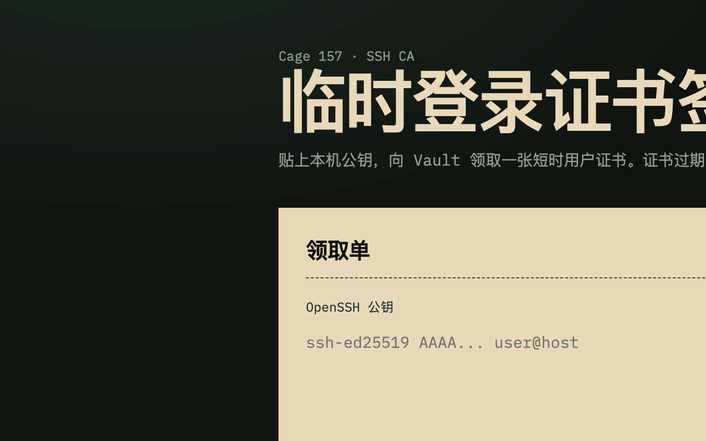
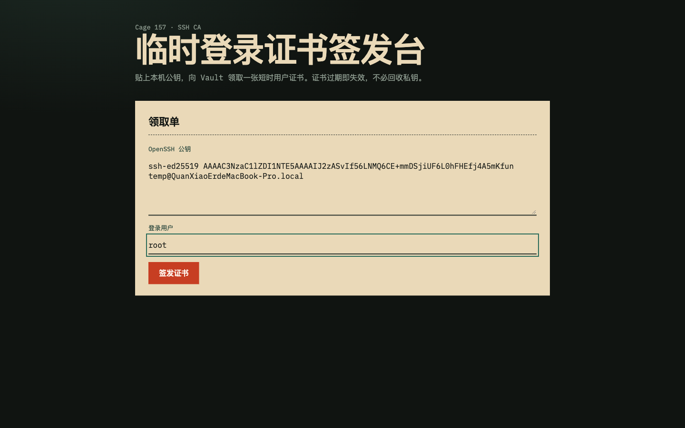
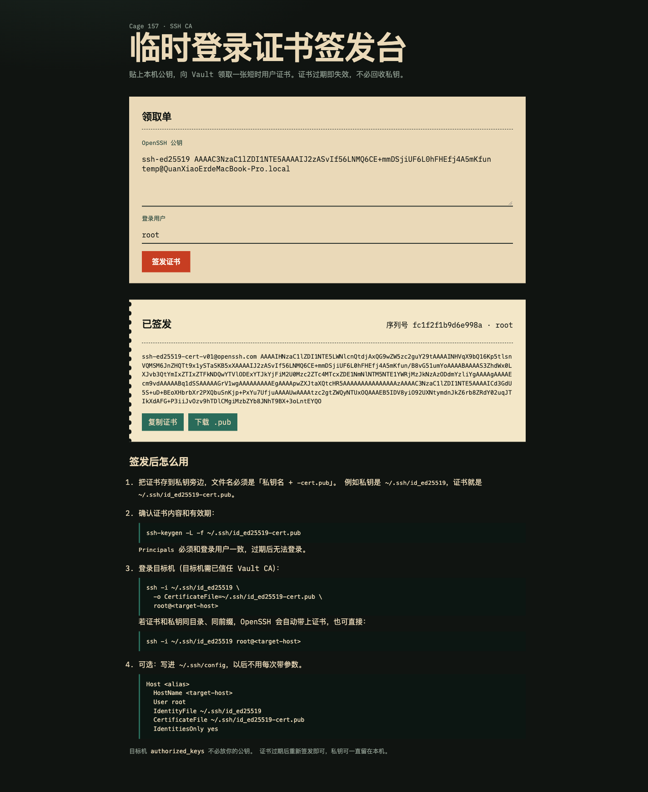

# 临时 SSH 登录证书签发

前端提交 OpenSSH 公钥，Go/Gin 后端向 Vault SSH CA 申请签名，把短期用户证书返回给前端。Vue 构建产物通过 `go:embed` 打进同一个二进制。

## 目录

```
backend/     Gin 服务
frontend/    Vue 3 + Vite 源码
docker/      镜像内默认配置
kubernetes/  k8s 部署清单
build/       构建产物（前端 dist + 二进制）
Makefile     构建、运行、镜像
```

## 配置

有两套 TLS，不要混用证书：

| 角色 | 需要的文件 | 配在哪 |
| --- | --- | --- |
| 本服务当 HTTPS 服务端 | CA、server 证书、server 私钥 | `server.tls` |
| 本服务当 Vault 客户端 | Vault CA、client 证书、client 私钥 | `VAULT_CACERT` / `VAULT_CLIENT_CERT` / `VAULT_CLIENT_KEY` |

复制 `backend/config.example.yaml` 为 `backend/config.yaml`，只放 HTTP/TLS 配置：

```yaml
server:
  addr: ":8080"
  cors_origins:
    - "http://localhost:5173"
  tls:
    cert_file: "<server-cert.pem>"       # 本服务证书
    key_file: "<server-key.pem>"         # 本服务私钥
    client_ca_file: "<client-ca.pem>"    # 校验客户端的 CA，不是 client.crt
    require_client_cert: true
```

服务端开 mTLS 只需要上面三份文件，不要把 `client.crt` / `client.key` 写进 `server.tls`。

Vault 信息必须从环境变量读取。启动时会校验，缺项会列出清单并退出：

```
load config: missing required environment variables:
  - VAULT_ADDR
  - VAULT_TOKEN
  - VAULT_ROLE
```

| 变量 | 必填 | 说明 |
| --- | --- | --- |
| `VAULT_ADDR` | 是 | Vault 地址 |
| `VAULT_TOKEN` | 是 | Vault token |
| `VAULT_ROLE` | 是 | SSH secrets engine 的签发 role |
| `VAULT_MOUNT` | 否 | 挂载路径，默认 `ssh` |
| `VAULT_NAMESPACE` | 否 | Enterprise 命名空间 |
| `VAULT_DEFAULT_PRINCIPALS` | 否 | 默认登录用户 |
| `VAULT_TLS_SKIP_VERIFY` | 否 | 跳过 Vault TLS 校验，默认 `false` |
| `VAULT_MTLS` | 否 | `true` 时强制要求本服务向 Vault 出示客户端证书 |
| `VAULT_CACERT` | 连 Vault 走 mTLS 时 | 校验 Vault 服务端证书的 CA |
| `VAULT_CLIENT_CERT` | 连 Vault 走 mTLS 时 | 本服务作为客户端出示给 Vault 的证书 |
| `VAULT_CLIENT_KEY` | 连 Vault 走 mTLS 时 | 对应私钥 |

这些变量只用于**本服务访问 Vault**，不会让本服务自己的 `:8080` 开启 mTLS。

设置 `VAULT_MTLS=true`，或任意填写 `VAULT_CACERT` / `VAULT_CLIENT_CERT` / `VAULT_CLIENT_KEY` 之一后，三份证书都必须存在，否则同样列出缺失项退出。

```bash
export VAULT_ADDR="https://<vault-host>:8200"
export VAULT_TOKEN="<vault-token>"
export VAULT_ROLE="<ssh-role>"
export VAULT_DEFAULT_PRINCIPALS="<login-user>"

# 仅当 Vault 要求客户端证书时（本服务作为 Vault 的客户端）
export VAULT_MTLS="true"
export VAULT_CACERT="/certs/ca.crt"
export VAULT_CLIENT_CERT="/certs/client.crt"
export VAULT_CLIENT_KEY="/certs/client.key"
```

### 本服务 TLS / mTLS

不填 `server.tls.cert_file` / `key_file` 时走明文 HTTP。配上服务端证书和私钥后启用 HTTPS；再配 `client_ca_file`（CA）即校验客户端证书（mTLS）。`require_client_cert: true` 时必须出示由该 CA 签发的客户端证书，否则握手失败。

服务端不加载 `client.crt` / `client.key`；那两份是访问方（浏览器、curl、Vite 代理）或连 Vault 时用的。

证书 SAN 含 `ssh.local`、`localhost`、`127.0.0.1`。浏览器访问请用这三个主机名之一。

macOS 导入客户端证书，并把 CA 设为始终信任：

```bash
open <client.p12>
open <ca.crt>
```

Vite 开发代理走 mTLS 时设置证书目录（不要把本机路径提交进仓库）：

```bash
export MTLS_CERT_DIR=<certs-dir>
export MTLS_CLIENT=<client-name>
```

```bash
# 仅 HTTPS
curl https://127.0.0.1:8080/api/health --cacert <server-ca.pem>

# mTLS
curl https://127.0.0.1:8080/api/health \
  --cacert <server-ca.pem> \
  --cert <client-cert.pem> \
  --key <client-key.pem>
```

证书有效期、允许的登录用户由 Vault SSH role 决定。

## Vault SSH role 示例

启用 SSH secrets engine 并生成 CA（若尚未配置）：

```bash
vault secrets enable -path=ssh ssh
vault write -f ssh/config/ca generate_signing_key=true
```

创建用于签发短期用户证书的 role：

```bash
vault write ssh/roles/<ssh-role> \
  key_type=ca \
  allow_user_certificates=true \
  allow_host_certificates=false \
  allowed_users="<login-user>" \
  default_user="<login-user>" \
  ttl=10m \
  max_ttl=30m \
  allowed_extensions="permit-pty" \
  default_extensions='{"permit-pty":""}'
```

等价 API：

```bash
curl -s \
  -H "X-Vault-Token: $VAULT_TOKEN" \
  -H "Content-Type: application/json" \
  -X POST http://<vault-host>:8200/v1/ssh/roles/<ssh-role> \
  -d '{
    "key_type": "ca",
    "allow_user_certificates": true,
    "allow_host_certificates": false,
    "allowed_users": "<login-user>",
    "default_user": "<login-user>",
    "ttl": "10m",
    "max_ttl": "30m",
    "allowed_extensions": "permit-pty",
    "default_extensions": {"permit-pty": ""}
  }'
```

`allowed_users` 限制证书 principal；`ttl` / `max_ttl` 由 Vault 决定证书有效期。`default_extensions` 必须包含 `permit-pty`，否则交互式登录通常分不到终端。

## 本地运行

```bash
make run          # 构建到 build/ 并启动
make open         # 同上，并打开浏览器
make build        # 产物：build/web、build/ssh-sign
make docker       # 交叉编译 linux 二进制，镜像 tag 为当前 git hash
make clean        # 删除二进制
```

开发时也可分开跑：

```bash
cd backend && go run . -config config.yaml
cd frontend && npm run dev    # http://localhost:5173，自动开浏览器
```

把返回的 `signed_key` 存为 `~/.ssh/id_ed25519-cert.pub`（与私钥同前缀），即可：

```bash
ssh -i ~/.ssh/id_ed25519 \
  -o CertificateFile=~/.ssh/id_ed25519-cert.pub \
  <login-user>@<target-host>
```

## Docker

镜像基于本机 `debian:bullseye-v1.4.1`，把内嵌前端的 linux 二进制直接复制进去，tag 为当前 git short hash。镜像内 `docker/config.yaml` 默认不配 `server.tls`，容器监听明文 HTTP。

```bash
make docker
docker run --rm -p 8080:8080 \
  -e VAULT_ADDR="https://<vault-host>:8200" \
  -e VAULT_TOKEN="<vault-token>" \
  -e VAULT_ROLE="<ssh-role>" \
  ssh-sign:<git-hash>
```

Vault 要求客户端证书时，再挂 **Vault 客户端** 证书（不是本服务的 server 证书）：

```bash
docker run --rm -p 8080:8080 \
  -e VAULT_ADDR="https://<vault-host>:8200" \
  -e VAULT_TOKEN="<vault-token>" \
  -e VAULT_ROLE="<ssh-role>" \
  -e VAULT_MTLS="true" \
  -e VAULT_CACERT="/certs/ca.crt" \
  -e VAULT_CLIENT_CERT="/certs/client.crt" \
  -e VAULT_CLIENT_KEY="/certs/client.key" \
  -v /path/to/vault-client-certs:/certs:ro \
  ssh-sign:<git-hash>
```

本服务自己对外开 mTLS 时，挂 CA、server 证书、server 私钥，并把容器内 `config.yaml` 的 `server.tls` 指到这些路径。不要把 `client.crt` / `client.key` 配进 `server.tls`。

未设置必填环境变量时容器会退出，并打印缺失清单。

## Kubernetes

清单在 `kubernetes/`，用 kustomize 部署。先改 `kubernetes/secret.yaml` 里的 Vault 地址、token、role，再把镜像 tag 换成刚构建的 git hash：

```bash
make docker
HASH=$(git rev-parse --short HEAD)

# 按实际仓库改镜像名；本地测试可先 docker save/load 到节点
cd kubernetes
kustomize edit set image ssh-sign=ssh-sign:${HASH}

# 编辑 secret.yaml 填入真实 Vault 信息后再 apply
kubectl apply -k .
```

默认会创建：

- Namespace `ssh-sign`
- ConfigMap：容器内 `/etc/ssh-sign/config.yaml`
- Secret `ssh-sign-vault`：`VAULT_ADDR` / `VAULT_TOKEN` / `VAULT_ROLE` 等
- Deployment + Service（ClusterIP `:8080`）

`kubernetes/mtls-patch.yaml` 和 Secret `ssh-sign-vault-mtls` 只用于 **本服务访问 Vault**（客户端证书），不会给本服务的 `:8080` 开 HTTPS/mTLS。ConfigMap 里 `server.tls` 默认是空的。

Vault 要求客户端证书时，先把 Vault CA 和客户端证书做成 Secret，再打开 kustomize patch：

```bash
kubectl -n ssh-sign create secret generic ssh-sign-vault-mtls \
  --from-file=ca.crt=/path/to/ca.crt \
  --from-file=client.crt=/path/to/client.crt \
  --from-file=client.key=/path/to/client.key
```

在 `kubernetes/kustomization.yaml` 取消注释：

```yaml
patches:
  - path: mtls-patch.yaml
```

证书会挂到 `/certs`，环境变量指向：

```
VAULT_CACERT=/certs/ca.crt
VAULT_CLIENT_CERT=/certs/client.crt
VAULT_CLIENT_KEY=/certs/client.key
```

本服务自己对外开 mTLS 时，改 ConfigMap 的 `server.tls`（CA + server 证书 + server 私钥），不要把上面的 `client.crt` / `client.key` 填进去。

访问：

```bash
kubectl -n ssh-sign port-forward svc/ssh-sign 8080:8080
curl http://127.0.0.1:8080/api/health
```

## 界面

打开页面后粘贴公钥，签发成功会返回证书内容与过期时间。

初始页：



填写公钥：



签发结果：



## 目标机信任 Vault CA

CA 公钥（无需 token，未认证接口）：

```bash
curl -s http://<vault-host>:8200/v1/ssh/public_key
```

或带 token：

```bash
curl -s -H "X-Vault-Token: $VAULT_TOKEN" http://<vault-host>:8200/v1/ssh/config/ca
```

在**每一台允许用临时证书登录的机器**上：

```bash
# 写入 CA 公钥，权限 0644，属主 root
install -m 0644 /dev/null /etc/ssh/trusted-user-ca-keys.pem
curl -s http://<vault-host>:8200/v1/ssh/public_key > /etc/ssh/trusted-user-ca-keys.pem

# sshd 信任该 CA 签发的用户证书
grep -q '^TrustedUserCAKeys' /etc/ssh/sshd_config \
  || echo 'TrustedUserCAKeys /etc/ssh/trusted-user-ca-keys.pem' >> /etc/ssh/sshd_config

sshd -t && systemctl reload sshd   # Debian/Ubuntu 也可能是: systemctl reload ssh
```

`sshd` 校验的是证书由该 CA 签出、未过期、principal 匹配登录用户。客户端私钥不必事先放进 `authorized_keys`。

客户端使用：

```bash
# 签发结果存为与私钥同前缀的 -cert.pub
ssh -i ~/.ssh/id_ed25519 \
  -o CertificateFile=~/.ssh/id_ed25519-cert.pub \
  <login-user>@<target-host>
```

## API

`GET /api/health`  
`GET /api/info` — 默认登录用户  
`POST /api/sign`

```json
{
  "public_key": "ssh-ed25519 AAAA...",
  "valid_principals": "<login-user>"
}
```

证书有效期由 Vault role 决定，请求里不传 TTL。

## License

[WTFPL](http://www.wtfpl.net/)
